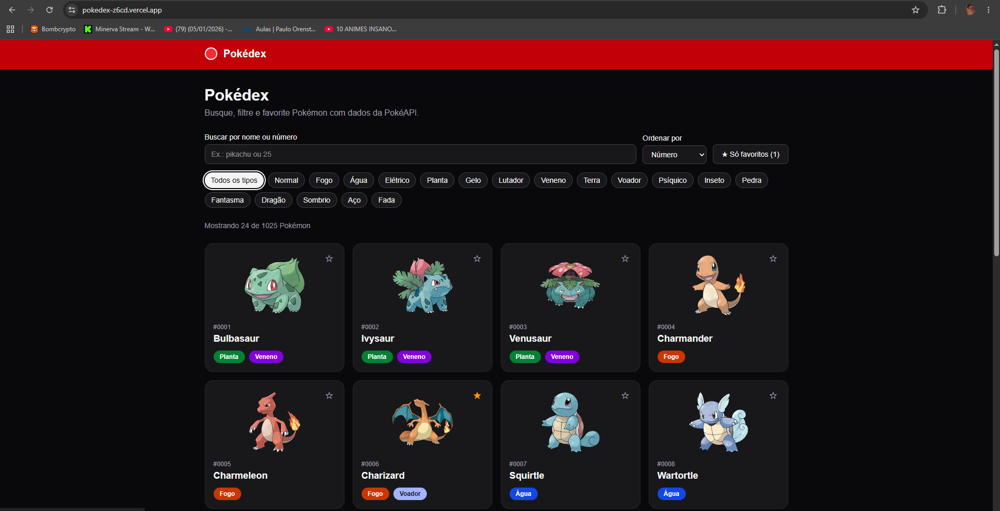
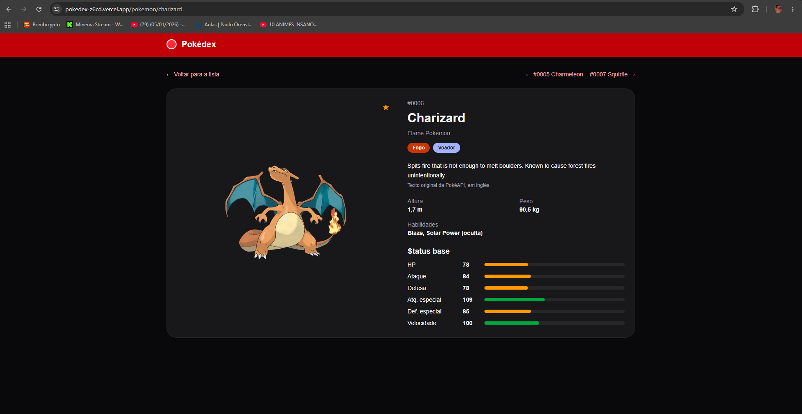

# Pokédex
  
Aplicação web para explorar Pokémon com dados da [PokéAPI](https://pokeapi.co): busca, filtro por tipo, favoritos e página de detalhes.

**Demo:** _(cole aqui o link da Vercel)_




## O que tem

- Lista com busca por nome ou número, filtro por tipo, ordenação e "carregar mais".
- Filtros guardados na URL (`?q=pika&tipo=electric&favoritos=1`): dá para recarregar, voltar e compartilhar.
- Favoritos salvos no `localStorage`, sincronizados entre componentes e abas.
- Página de detalhes com status base, altura, peso, habilidades, descrição e navegação para o anterior/próximo.
- Estados de **carregamento, erro, vazio e sucesso** em todas as telas (skeletons, botão "Tentar novamente", mensagens de lista vazia, aviso ao favoritar).
- Responsivo (1 a 4 colunas) e com modo escuro automático.

## Stack

Next.js (App Router) · React · TypeScript · Tailwind CSS · TanStack Query · Vitest + React Testing Library

## Como rodar

```bash
npm install
npm run dev      # http://localhost:3000
npm test         # testes
npm run lint
npm run build
```

## Estrutura

```
app/                 rotas (lista, detalhe, error boundary) e layout
components/          componentes reutilizáveis (Button, Card, StatBar, StateMessage, ...)
hooks/               usePokemon (React Query), useFavorites, useDebounce
lib/                 cliente da API, tipos e funções utilitárias
```

## Decisões técnicas

- **Lista inteira em uma requisição só** (`/pokemon?limit=2000`, ~1 KB por 100 itens): busca, filtros e ordenação rodam no cliente, sem uma chamada por tecla digitada. Os tipos de cada card são buscados sob demanda e cacheados pelo React Query.
- **Filtros na URL** em vez de `useState`, para estado compartilhável e navegação previsível. O texto da busca usa debounce de 300 ms antes de ir para a URL.
- **Favoritos com `useSyncExternalStore`**: lê o `localStorage` sem causar diferença entre o HTML do servidor e o do cliente.
- **Acessibilidade**: HTML semântico, `aria-pressed` nos botões de alternância, `role="status"`/`role="alert"` nos estados, `role="meter"` nas barras de status, foco visível, link "Ir para o conteúdo" e cores com contraste AA.
- **Testes**: utilitários, hook de favoritos, estados de erro/vazio e o card nos três estados (carregando, sucesso, erro) com `fetch` simulado.

## Uso de IA

Este projeto foi desenvolvido com apoio de IA (Claude) para gerar a base do código e tirar dúvidas. Revisei, executei e adaptei o código, e consigo explicar cada parte dele.

## VulcaNET
